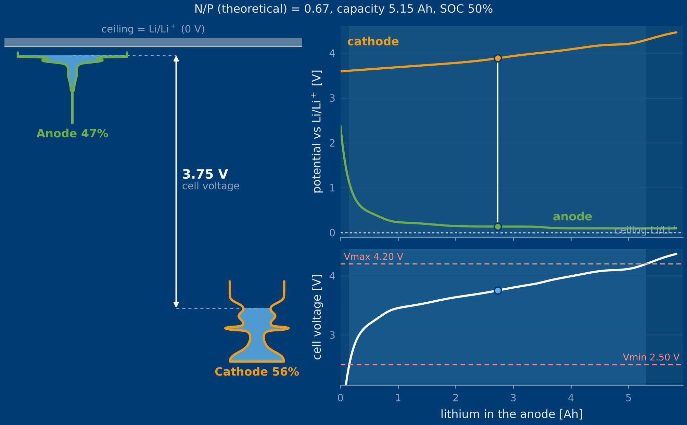
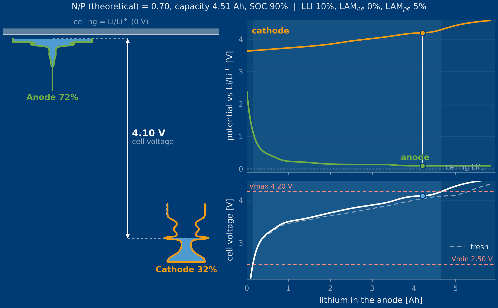
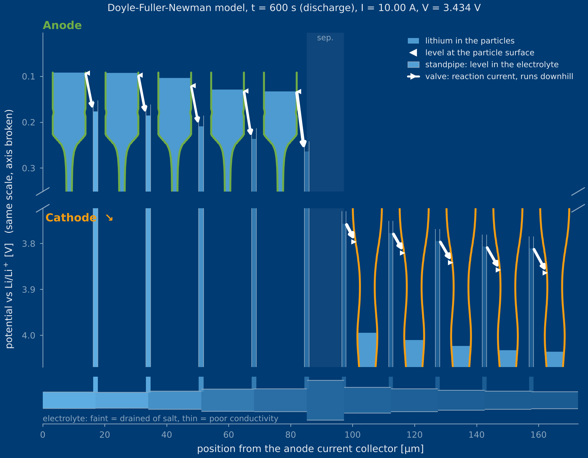
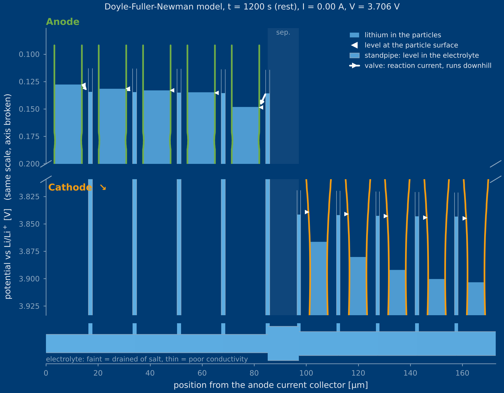

# pytanks

**Battery models drawn as tanks, pipes and valves.** pytanks turns [PyBaMM](https://pybamm.org) parameter sets and simulations into figures in the picture language of [chargetanks.com](https://chargetanks.com): each electrode is a tank whose width is its capacity per volt (dQ/dU), the water in it is lithium, and water only ever runs downhill.

```bash
pip install git+https://github.com/lvk93/pytanks
```

```python
import pybamm, pytanks

fig, ax = pytanks.plot_balance(pybamm.ParameterValues("Chen2020"), soc=0.5)
fig.savefig("balance.pdf")
```



## What it shows

### 1. Lithium balance (equilibrium)

`plot_balance(parameter_values, soc, lli=, lam_ne=, lam_pe=)` draws both tanks hanging from the Li/Li⁺ ceiling, the half-cell potentials over the lithium in the anode and the cell voltage with its window. The operating window comes from PyBaMM's `ElectrodeSOHSolver`. Degradation modes are applied to the inventories (Q_Li, Q_n, Q_p), and the fresh cell is shown dashed for comparison.



### 2. The ladder (kinetics)

`plot_ladder(simulation, t)` cuts each electrode into slices through its thickness and draws one tank per slice. It works with the SPMe and DFN. Anode (top) and cathode (bottom) are two zoom windows on the *same* scale with the potential axis broken in between, so the cathode hangs below the anode as in the balance picture.

| element | meaning | PyBaMM variable |
|---|---|---|
| tank shape | OCP of the electrode (width = dQ/dU, capped on plateaus) | OCP function of the parameter set |
| water surface | mean lithiation of the slice | `R-averaged … particle concentration` |
| notch ◂ | equilibrium level at the particle surface | `… electrode open-circuit potential` |
| standpipe | rises from the electrolyte pipe next to each tank; its water level is φs − φe (what a Li reference in the electrolyte there would read) | `… electrode surface potential difference` |
| arrow | valve = charge transfer: where lithium crosses the interface, which way, how much (width ∝ local current density, slope = overpotential) | `… electrode interfacial current density` |
| pipe | electrolyte: faint = drained of salt, thin = poor effective conductivity | `… electrolyte concentration`, `… transport efficiency` |

Standpipe level vs. notch is the reaction overpotential. Notch vs. water surface is how far solid diffusion lags behind. If the anode's pipe level at the separator drops below 0 V, lithium plating becomes possible, even when the tanks are not full yet.



During a rest the tanks equalise with each other through the pipe:



Every layer can be switched off (`notch=`, `valves=`, `risers=`, `pipe=`, `legend=`) to keep paper figures lean.

### Where the picture stops

* **Electrolyte:** part of the current comes from salt diffusion (transference number), not from the slope of the pipe level. In a rest the level gradient can therefore persist until the concentration has evened out. That is physics, not a drawing error.
* **Electrons:** the solid-phase drop is hidden in the pipe level. Its slope does not separate ionic from electronic losses (relevant for poorly conducting electrodes such as LFP).
* **Solid diffusion:** PyBaMM uses Fick's law by default. On a plateau that means water flowing without a level difference. The tank picture makes this visible: the real driving force is the potential, not the concentration.
* **Double layer:** not drawn yet.

## Figures for papers

* Two themes: `theme="site"` (default, navy as on chargetanks.com) and `theme="paper"` (white for print).
* `figsize("single")` = 85 mm, `figsize("double")` = 170 mm wide.
* PDF and SVG keep fonts as text (`pdf.fonttype 42`, `svg.fonttype none`). PNG is saved at 600 dpi by default.
* Every function returns `(fig, axes)`, so everything stays editable with plain matplotlib.
* `pytanks.style_path()` is a plain `.mplstyle` file. Use it for your own plots with `plt.style.use(pytanks.style_path())`, or copy and edit it.
* Building blocks: `draw_tanks`, `draw_electrodes`, `draw_cell`, `tank_profile`, `draw_tank`, `ladder` (data only).

## One source of truth with chargetanks.com

pytanks is the reference implementation. `python -m pytanks.fixtures out_dir` writes `tokens.json` (colours, line widths, geometry) and reference fixtures, which the website's JavaScript is tested against.

## Development

```bash
pip install -e ".[dev]"
pytest
python examples/make_figures.py   # README figures
```

Tested against the latest and the previous PyBaMM release. The tests guard the physics conventions: every valve arrow must run downhill, the water volume of the slice tanks must equal the lithium PyBaMM has in the electrode, and tanks may never touch.

## Roadmap

See [ROADMAP.md](ROADMAP.md). Next: the diffusion zoom (one tank resolved into shells, animated), an overview inset next to the zoomed ladder, and a JOSS paper.

## Citing

See [CITATION.cff](CITATION.cff). The tank picture language comes from [chargetanks.com](https://chargetanks.com) by Lars von Kolzenberg. The drawing code is ported from the website's lithium-balance chapter.

BSD-3-Clause, like PyBaMM.
